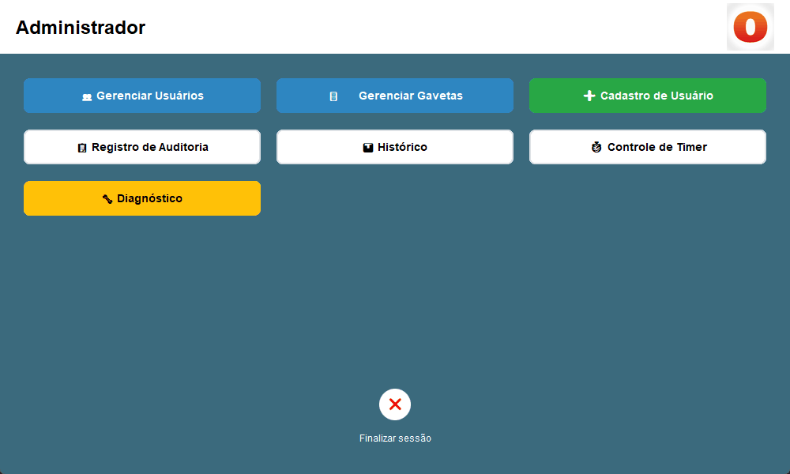
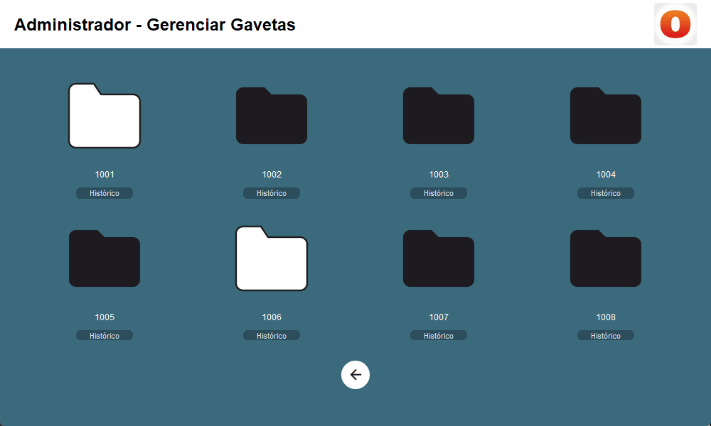
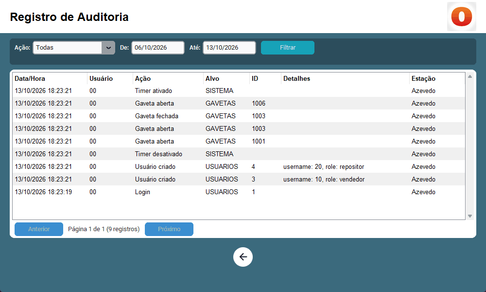

# Ozempic Seguro

[](https://github.com/caique-az/ozempic-seguro/actions/workflows/ci.yml)

[](https://github.com/astral-sh/ruff)

[](LICENSE)

Aplicação desktop para controlar o acesso a gavetas de medicamentos termolábeis (como o Ozempic) em pontos de venda. Ela roda offline em um mini PC com tela touch e garante que cada perfil faça só o que pode, que aberturas em sequência sejam bloqueadas e que toda ação fique registrada.

📖 **Documentação completa:** [`docs/`](docs/README.md)



## Funcionalidades

- **Controle de acesso por perfil**: vendedor abre, repositor fecha, técnico faz manutenção e administrador gerencia tudo.
- **Bloqueio após abertura**: depois que uma gaveta é aberta, novas aberturas ficam bloqueadas por alguns minutos.
- **Auditoria completa**: logins, aberturas, fechamentos e alterações de usuários, com usuário, horário e estação.
- **Proteção contra força bruta** e **expiração de sessão por inatividade**.
- **Interface touch** com teclados virtuais e senhas numéricas.

| Gavetas | Auditoria |
|---|---|
|  |  |

## Arquitetura

O código é organizado em camadas, e as regras de negócio não dependem de interface nem de banco de dados:

```text
presentation ──► application ──► domain ◄── infrastructure
 (CustomTkinter)  (casos de uso)  (regras e ports)  (SQLite, bcrypt)
                        ▲                                 │
                        └────────── bootstrap.py ─────────┘
```

- **domain**: perfis, matriz de permissões, política de credenciais e interfaces (`Protocol`) para tudo que é externo.
- **application**: casos de uso (login, abrir e fechar gavetas, gerenciar usuários, auditoria, timer) com dependências injetadas.
- **infrastructure**: SQLite com migrações versionadas, bcrypt, relógio e configuração.
- **presentation**: telas que apenas exibem dados e chamam os casos de uso.

Veja a [página de arquitetura](docs/arquitetura.md) e as [decisões registradas (ADRs)](docs/adr/README.md).

## Como rodar

Requer Python 3.13 com Tkinter.

```bash
git clone https://github.com/caique-az/ozempic-seguro.git
cd ozempic-seguro
python -m venv .venv
.venv\Scripts\activate          # Linux/macOS: source .venv/bin/activate
pip install -e ".[dev]"
cp .env.example .env            # defina as senhas iniciais
python -m ozempic_seguro
```

Na primeira execução são criados um administrador (usuário `00`) e um técnico (usuário `01`), com as senhas definidas no `.env`. Todas as variáveis estão descritas em [Primeiros passos](docs/primeiros-passos.md).

## Qualidade

```bash
pytest          # testes; cobertura mínima de 95% em domínio, aplicação e infraestrutura
ruff check .    # lint
ruff format .   # formatação
mypy            # tipos em modo strict
```

- Testes organizados por camada: regras puras, casos de uso com *fakes* em memória e relógio controlável, persistência com SQLite real e um teste de ponta a ponta.
- *Smoke test* que abre todas as telas de verdade (roda onde há display, como o runner Windows do CI).
- CI no GitHub Actions com lint, tipos e testes no Ubuntu e no Windows.

## Stack

Python 3.13 · CustomTkinter · SQLite · bcrypt · pytest · Ruff · mypy · GitHub Actions

## Licença

[MIT](LICENSE) © Caique Azevedo
