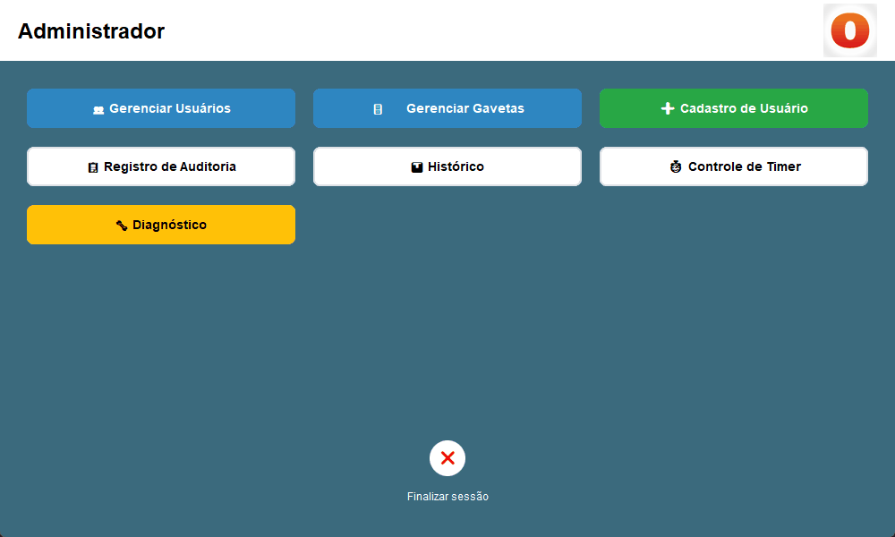
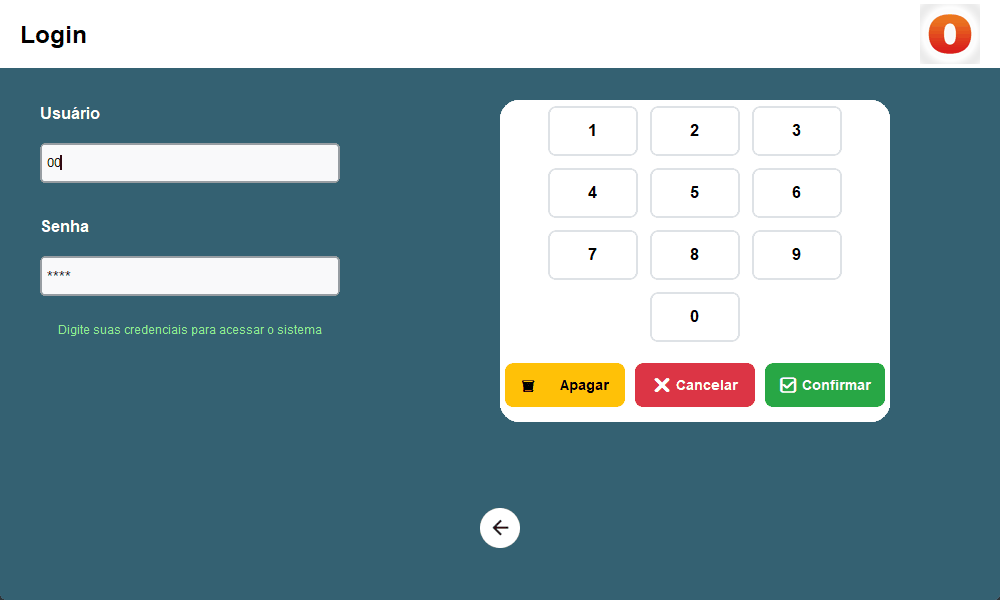
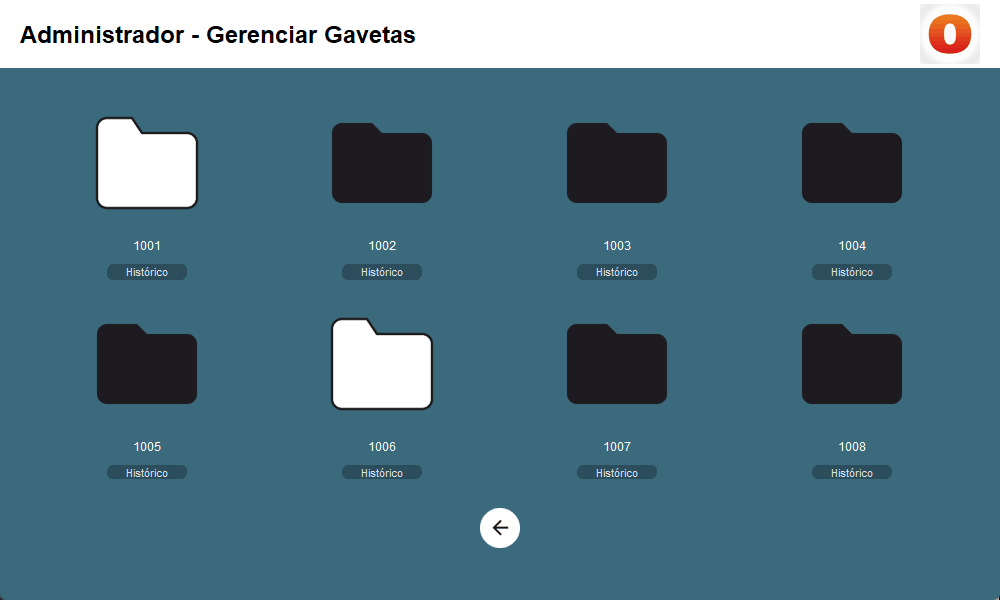
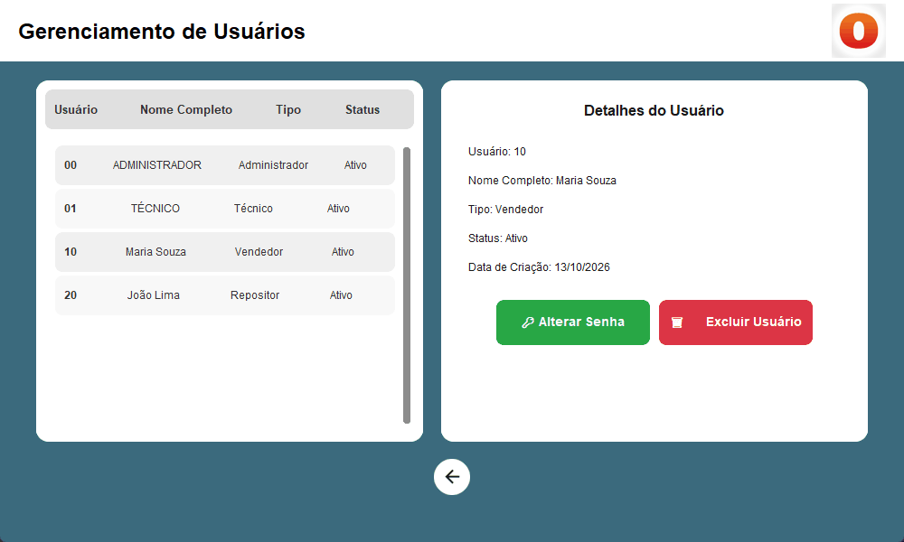
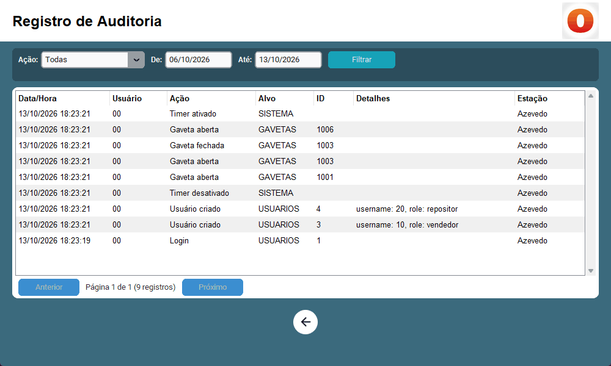

# Ozempic Seguro

Aplicação desktop para controlar o acesso a gavetas de medicamentos termolábeis (como o Ozempic) em pontos de venda. Ela roda em um mini PC com tela touch acoplado às gavetas, 100% offline.

## O que o sistema faz

- **Controle de acesso por perfil**: vendedores só abrem gavetas, repositores só fecham, técnicos cuidam da manutenção e administradores gerenciam tudo.
- **Bloqueio após abertura**: depois que uma gaveta é aberta, novas aberturas ficam bloqueadas por alguns minutos, o que dificulta retiradas em sequência.
- **Trilha de auditoria**: logins, logouts, aberturas e fechamentos de gaveta e alterações de usuários ficam registrados com data, usuário e estação.
- **Proteção contra força bruta**: o usuário é bloqueado temporariamente após tentativas de login incorretas.
- **Sessão com expiração**: a sessão termina sozinha após um período sem uso, e a tela volta ao início.

## Telas

| Login | Gavetas |
|---|---|
|  |  |

| Usuários | Auditoria |
|---|---|
|  |  |

## Tecnologias

| Área | Escolha |
|---|---|
| Linguagem | Python 3.13 |
| Interface | CustomTkinter, com teclado virtual para tela touch |
| Persistência | SQLite com migrações SQL versionadas |
| Segurança | bcrypt para senhas |
| Arquitetura | Camadas (domínio, aplicação, infraestrutura, apresentação) com injeção de dependências |
| Qualidade | pytest (cobertura ≥ 95% nas camadas de lógica), Ruff, mypy em modo strict, GitHub Actions |

## Por onde começar

- Para rodar o projeto: [Primeiros passos](primeiros-passos.md).
- Para entender o que o sistema garante: [Regras de negócio](regras-de-negocio.md).
- Para entender o código: [Arquitetura](arquitetura.md) e as [decisões registradas](adr/README.md).
