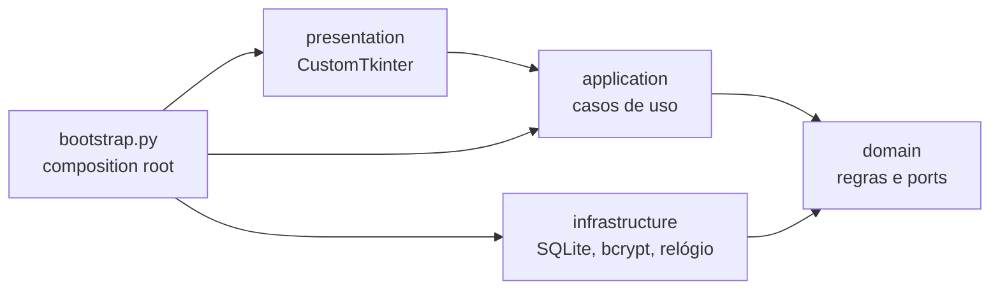

# Arquitetura

O código segue uma arquitetura em camadas inspirada na Clean Architecture. As regras de negócio não conhecem Tkinter, SQLite nem bcrypt: dependem apenas de interfaces (`Protocol`), e as implementações concretas são conectadas em um único ponto. Os motivos estão na [ADR 0001](adr/0001-arquitetura-em-camadas.md).

## Camadas e regra de dependência



As setas indicam "depende de". O domínio não depende de nada; a infraestrutura implementa as interfaces que o domínio declara; só o `bootstrap.py` conhece todas as camadas.

| Camada | Responsabilidade | Pode importar |
|---|---|---|
| `domain/` | Entidades, regras (permissões, política de credenciais), exceções e *ports* | só a biblioteca padrão |
| `application/` | Casos de uso: orquestram o domínio, verificam permissões e registram auditoria | `domain` |
| `infrastructure/` | SQLite, migrações, bcrypt, relógio, configuração e logs | `domain` |
| `presentation/` | Telas e widgets; mostram dados e repassam as ações do usuário | `application`, `domain` |
| `bootstrap.py` | Cria as implementações e injeta nos casos de uso | todas |

## Estrutura de pastas

```text
src/ozempic_seguro/
├── domain/
│   ├── users.py           # User, Role, CredentialPolicy
│   ├── permissions.py     # matriz perfil × permissão
│   ├── drawers.py         # DrawerEvent, DrawerAction
│   ├── audit.py           # AuditAction, AuditEntry, AuditFilter
│   ├── exceptions.py      # DomainError e subclasses (mensagens para o usuário)
│   └── ports.py           # UserRepository, DrawerRepository, AuditLog, PasswordHasher, Clock
├── application/
│   ├── auth.py            # login, logout, expiração por inatividade
│   ├── drawers.py         # abrir, fechar, histórico
│   ├── users.py           # cadastro, troca de senha, desativação
│   ├── audit.py           # consulta da auditoria
│   ├── timer.py           # bloqueio após abertura
│   ├── state.py           # Session, LoginThrottle, SystemLock (estado em memória)
│   └── pagination.py      # Page[T]
├── infrastructure/
│   ├── settings.py        # Settings (variáveis OZEMPIC_* e .env)
│   ├── system.py          # SystemClock, BcryptPasswordHasher
│   ├── logs.py            # arquivo de log com rotação
│   └── persistence/
│       ├── database.py    # conexão, transações, migrações
│       ├── migrations/    # 001_initial.sql, 002_indexes.sql, ...
│       ├── *_repository.py
│       └── seed.py        # usuários padrão
├── presentation/
│   ├── app.py             # janela principal, verificação de inatividade
│   ├── navigation.py      # troca de telas e fluxo da sessão
│   ├── formatting.py      # conversões de datas e rótulos (sem Tk)
│   ├── screens/           # uma tela por etapa do fluxo; admin/ para o painel
│   └── widgets/           # botões, diálogos, teclados, grade de gavetas, tabela
├── bootstrap.py           # build_services()
└── main.py                # ponto de entrada
```

## Composition root

`bootstrap.build_services(settings)` cria o banco, os repositórios e os casos de uso e os devolve em um objeto `Services`. Não há singletons nem *service locator*: cada objeto recebe suas dependências pelo construtor.

```python
settings = Settings.from_env()
services = build_services(settings)
services.auth.login("00", "1234")
services.drawers.open(1001)
```

Isso permite que os testes montem os casos de uso com implementações em memória (veja `tests/application/conftest.py`) e que um teste de ponta a ponta use as implementações reais (veja `tests/test_bootstrap.py`).

## Fluxo de uma requisição

Abrir uma gaveta passa por todas as camadas:

1. **Apresentação**: `DrawerButton` recebe o toque, pede confirmação se o timer está ligado e chama `services.drawers.open(1001)`.
2. **Aplicação**: `DrawerService.open` obtém o usuário da sessão, verifica a permissão, consulta o `SystemLock`, grava a mudança, registra a auditoria e inicia o bloqueio.
3. **Domínio**: fornece a matriz de permissões (`require`, `opening_locks_system`) e as exceções.
4. **Infraestrutura**: `SqliteDrawerRepository.set_open` atualiza o estado e o histórico na mesma transação; `SqliteAuditRepository.record` grava o evento.

Se uma regra é violada, o caso de uso lança uma `DomainError` com mensagem para o usuário, e `Screen.attempt` a exibe. A interface nunca decide se uma ação é permitida.

## Estado em memória e tempo

`Session`, `LoginThrottle` e `SystemLock` recebem um `Clock`. Nenhum deles usa threads ou timers: a interface consulta o estado periodicamente com `after()` do Tkinter (que não é thread-safe), e os testes avançam o relógio sem esperar. Detalhes na [ADR 0003](adr/0003-estado-sem-threads.md).

## Tratamento de erros

- `DomainError` e subclasses: violações de regra, sempre com mensagem pronta para o usuário.
- `ConfigurationError`: configuração inválida, reportada antes de abrir a janela.
- `MigrationError`: falha ao aplicar uma migração; a aplicação não inicia com o schema pela metade.
- Erros inesperados são registrados em `logs/app.log`.
