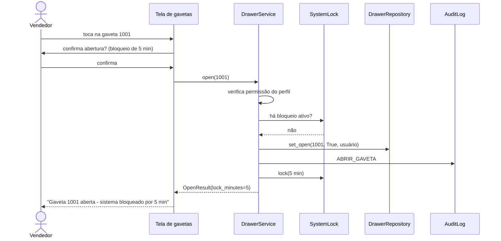

# Casos de uso

Cada caso de uso corresponde a um método da camada de aplicação (`src/ozempic_seguro/application/`). A coluna "Implementação" indica onde ele fica.

## Visão geral

| Ator | Caso de uso | Implementação |
|---|---|---|
| Todos | Entrar no sistema | `AuthService.login` |
| Todos | Finalizar a sessão | `AuthService.logout` |
| Sistema | Encerrar sessão inativa | `AuthService.expire_if_idle` |
| Vendedor, Administrador | Abrir gaveta | `DrawerService.open` |
| Repositor, Administrador | Fechar gaveta | `DrawerService.close` |
| Vendedor, Repositor, Administrador | Consultar histórico de uma gaveta | `DrawerService.history` |
| Administrador | Consultar histórico de todas as gavetas | `DrawerService.all_history` |
| Administrador | Cadastrar usuário | `UserService.register` |
| Administrador | Trocar senha de usuário | `UserService.change_password` |
| Administrador | Excluir (desativar) usuário | `UserService.delete` |
| Administrador | Consultar auditoria | `AuditService.search` |
| Técnico, Administrador | Ligar ou desligar o timer | `TimerService.enable` / `disable` |
| Administrador | Remover bloqueio ativo | `TimerService.clear_lock` |
| Técnico, Administrador | Diagnóstico das gavetas | tela de demonstração, sem caso de uso (ver abaixo) |

## Entrar no sistema

1. Na tela inicial, o usuário toca na tela e escolhe **Iniciar Sessão**.
2. Digita usuário e senha no teclado numérico e confirma.
3. O sistema valida as credenciais e abre a tela inicial do perfil: painel do administrador, grade de gavetas (vendedor e repositor) ou menu do técnico.

**Alternativas**

- Credenciais inválidas: a tela informa quantas tentativas restam.
- Limite de tentativas atingido: a conta fica bloqueada e a tela mostra uma contagem regressiva até poder tentar de novo.

## Abrir gaveta

**Alternativas**

- Sistema bloqueado por uma abertura recente: a abertura é recusada, e a mensagem informa o tempo restante.
- Perfil sem permissão (repositor ou técnico): a ação é recusada com uma mensagem.
- Timer desligado: não há confirmação nem bloqueio.

## Fechar gaveta

O repositor ou o administrador toca em uma gaveta aberta. O sistema registra o fechamento no histórico e na auditoria. Fechar não depende do timer.

## Consultar histórico

- **De uma gaveta**: o botão **Histórico** abaixo de cada gaveta abre a lista de aberturas e fechamentos, com usuário e horário, em páginas de 20.
- **De todas as gavetas**: no painel do administrador, a opção **Histórico** mostra todas as movimentações, das mais recentes para as mais antigas.

## Cadastrar usuário

1. O administrador abre **Cadastro de Usuário**.
2. Preenche nome, usuário e senha pelo teclado virtual e escolhe o perfil.
3. Toca em **SALVAR** e confirma.
4. O sistema valida os dados (veja [credenciais](regras-de-negocio.md#credenciais)), cria o usuário e registra o evento.

Se houver erros, todos aparecem de uma vez abaixo do formulário.

## Gerenciar usuários

Em **Gerenciar Usuários**, o administrador seleciona um usuário na lista e pode:

- **Alterar a senha**: digita a nova senha duas vezes no teclado numérico.
- **Excluir**: após confirmação, o usuário é desativado e passa a aparecer como "Inativo".

Técnicos e usuários já desativados aparecem com um aviso, e as ações ficam indisponíveis.

## Consultar auditoria

O administrador abre **Registro de Auditoria**, filtra por evento e período (datas no formato dd/mm/aaaa) e navega pelas páginas. Um duplo clique em um registro mostra todos os detalhes.

## Controlar o timer

Em **Controle de Timer**, disponível para técnicos e administradores, a tela mostra se o timer está ligado e quanto tempo de bloqueio resta. É possível desligar o timer (com confirmação) ou religá-lo. O administrador também pode remover um bloqueio em andamento.

## Diagnóstico

A tela de diagnóstico mostra o layout previsto para o status do hardware (gavetas conectadas, abertas e com defeito). Ainda não existe integração com o hardware: os dados são simulados, e a própria tela avisa isso.
