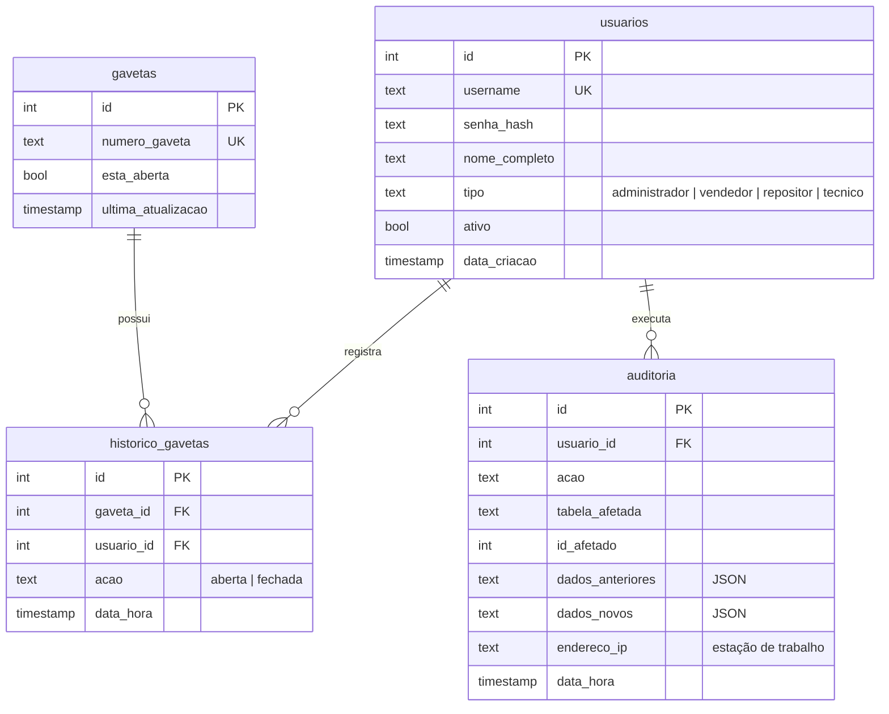

# Dados e migrações

## Banco de dados

O sistema usa um único arquivo SQLite, por padrão em `src/ozempic_seguro/data/ozempic_seguro.db` (configurável por `OZEMPIC_DB_PATH`). A conexão ativa:

- `foreign_keys = ON`, para que nenhum registro aponte para algo inexistente;
- `journal_mode = WAL`, para que leituras não bloqueiem gravações e as escritas sejam mais rápidas.

Toda escrita passa por `Database.transaction()`, que confirma ao final ou desfaz tudo em caso de erro. Abrir uma gaveta, por exemplo, atualiza o estado e grava o histórico na mesma transação.

## Schema

Os nomes de tabelas e colunas estão em português desde a primeira versão. Eles foram mantidos para preservar bancos existentes; os repositórios fazem a tradução para os objetos do domínio.

> [!NOTE]
> **Coluna `endereco_ip`.** O sistema é offline, então a coluna guarda o nome da estação que gerou o evento. O nome foi mantido por compatibilidade com o schema original.

## Datas e fuso horário

O SQLite grava `CURRENT_TIMESTAMP` em UTC. Os repositórios convertem para o horário local ao ler, e os filtros por data da auditoria consideram o dia no horário local. Assim, registros antigos e novos aparecem de forma consistente.

## Migrações

As migrações ficam em `src/ozempic_seguro/infrastructure/persistence/migrations/` e seguem o padrão `NNN_descricao.sql`. Ao abrir o banco:

1. A tabela `migrations` guarda as versões já aplicadas.
2. Os arquivos ainda não aplicados rodam em ordem numérica.
3. Se um script falhar, a inicialização é interrompida com `MigrationError`.

| Versão | Conteúdo |
|---|---|
| 001 | Tabelas `usuarios`, `gavetas`, `historico_gavetas` e `auditoria` |
| 002 | Índices para o histórico de gavetas e para a auditoria |

> [!TIP]
> **Alterando o schema.** Crie um novo arquivo com o próximo número. Nunca edite uma migração já publicada: bancos existentes não a executariam de novo.

## Exclusão de usuários

Usuários não são apagados, apenas desativados (`ativo = 0`). A auditoria e o histórico de gavetas fazem referência a eles com chaves estrangeiras, e apagar o registro quebraria essa trilha. Veja a [ADR 0002](adr/0002-desativar-usuarios.md).
